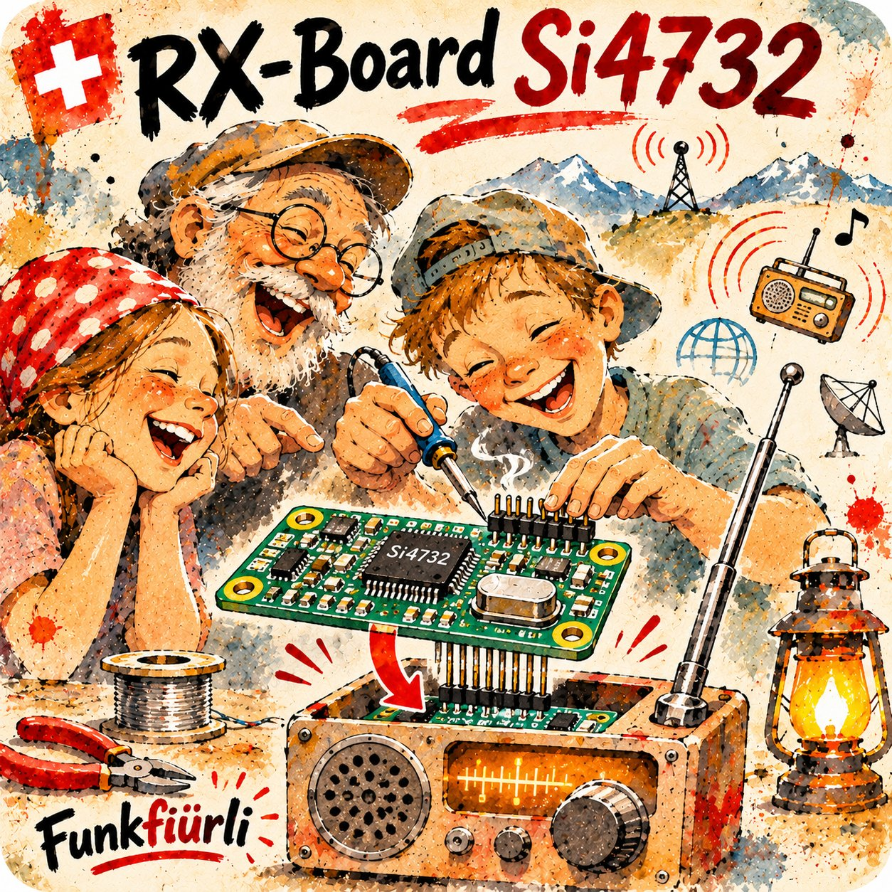

# RX-Board Si4732

Pluggable receiver module for the [Funkfüürli](https://github.com/MaShaoDe/Funkfuerli), a build-it-yourself emergency radio for children and pupils.

The board carries the Si4732-A10 AM/FM/SW/LW/RDS receiver IC with crystal and support parts. It is ordered fully assembled, so children only solder the pin headers.

**Status:** draft, Rev A in progress. No manufacturing data yet.

* Description, pinout and requirements (German): [docs/rx-board.md](docs/rx-board.md)
* Licenses: [LICENSE.md](LICENSE.md)

Copyright 2026 FerienBSD aka Marcel Sauder. Hardware CERN-OHL-P-2.0, documentation CC-BY-4.0.
