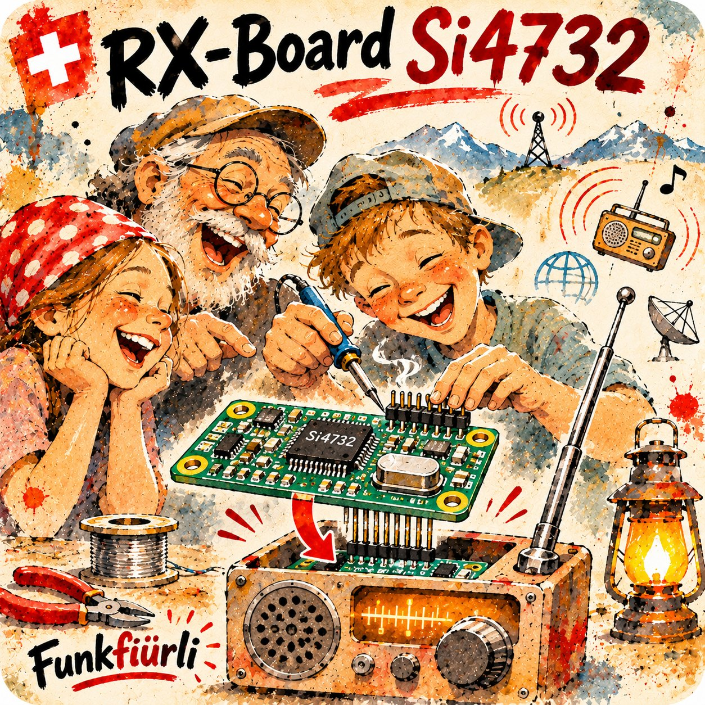

# RX-Board Si4732

Steckbare Empfänger-Baugruppe für das [Funkfüürli](https://github.com/MaShaoDe/Funkfuerli), das Notfallradio zum Selberbauen für Kinder und Schüler.

Das RX-Board trägt den Empfängerchip Si4732-A10 (UKW, MW, KW, LW, RDS) mit Quarz und Beschaltung. Es wird komplett bestückt bestellt. Die Kinder löten nur die Stiftleisten.

**Stand:** Rev A ist bestellt, gefertigt und unterwegs. Die Tests folgen nach Lieferung (siehe [docs/labortest.md](docs/labortest.md)). Bekannte Fehler auf Rev A werden in Rev B korrigiert.

* Beschreibung, Pinbelegung und Anforderungen: [docs/rx-board.md](docs/rx-board.md)
* Englische Kurzfassung: [README.en.md](README.en.md)
* Lizenzen: [LICENSE.md](LICENSE.md)

## Ordner

| Ordner | Inhalt |
|---|---|
| `docs/` | Beschreibung, Anforderungen, Prüfanleitung |
| `hardware/` | KiCad Projekt, Fertigungsdaten Rev A (Stückliste, Bestückungsliste) |
| `LICENSES/` | Lizenztexte |

## Plan

1. Erledigt: Schaltplan, Layout und Fertigungsdaten Rev A, Fertigung bei JLCPCB.
2. Offen: Test Rev A (Testprogramm liest Chip aus und stimmt einen Sender ab).
3. Offen: Fehler von Rev A sammeln, Layout Rev B.

Copyright 2026 FerienBSD aka Marcel Sauder. Hardware CERN-OHL-P-2.0, Doku CC-BY-4.0.
